<!-- ═══════════════════════════════════════════════════ -->
<!--       JOSHUA PETER S — SCUDERIA TELEMETRY          -->
<!--        Upload ALL .svg files + README.md           -->
<!--         to your Joshua-Peter7 profile repo         -->
<!-- ═══════════════════════════════════════════════════ -->

<!-- LIVE ANIMATED TELEMETRY TICKER -->

  

---

## 🏎️ 3D Telemetry & Sector Times

<!-- 3D ISOMETRIC CONTRIBUTION GRAPH (Powered by GitHub Actions) -->

  

<!-- ANIMATED CONTRIBUTION SNAKE / RACE TRACK (Powered by GitHub Actions) -->

  

---

## 📊 Constructor Standings & Engine Diagnostics

<!-- ANIMATED TROPHY CABINET -->

  

<!-- CORE TELEMETRY CARDS -->

  
  &nbsp;
  

<!-- STREAK TELEMETRY -->

  

<!-- LIVE RPM / COMMIT ACTIVITY WAVE GRAPH -->

  

---

## 📡 Pit Wall Radio & Comms

  &nbsp;
  &nbsp;
  &nbsp;
  

  

