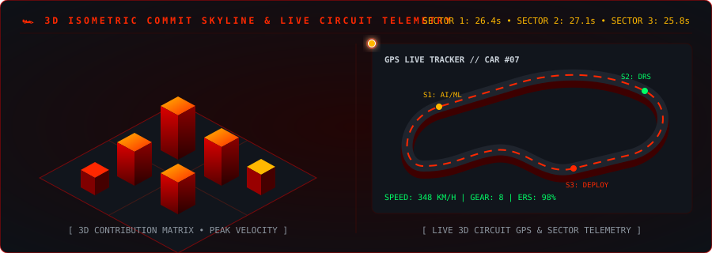
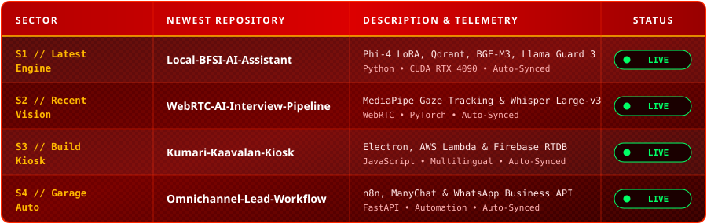

<!-- ═══════════════════════════════════════════════════ -->
<!--       JOSHUA PETER S — SCUDERIA TELEMETRY          -->
<!-- ═══════════════════════════════════════════════════ -->

   
   
   
   
  

---

## 🏎️ 3D Telemetry & Sector Times

  

 

  
<b>🎛️ INTERACTIVE PIT WALL CONSOLE — Click to Expand/Collapse Latest Projects</b>

   
  

    
  

---

## 📊 Constructor Standings & Engine Diagnostics

  
   
  
   
  
   
  

  
   
  

  

  

---

## 📡 Pit Wall Radio & Comms

   
   
   
  

  

